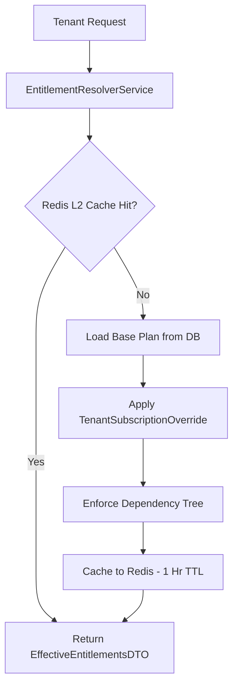

# CRMLite Backend — Comprehensive Subscription Plans, Pricing & Limits Report
**Generated from Verified Source Code & Live Database**  
**Date:** October 2026 | **Version:** Canonical Tier Engine (V11051 / V11052)

---

## 1. Executive Summary & Architecture Overview

The CRMLite subscription architecture is designed as a **Multi-Tier, Multi-Currency, Multi-Tenant Entitlement & Quota Enforcement Engine**. 

### Core Architectural Components:
1. **Canonical Tiers**: Strict 5-tier model (`FREE`, `STARTER`, `GROWTH`, `SCALE`, `ENTERPRISE`). Legacy tiers (`PRO`, `MIN`) were purged and migrated to `GROWTH` in migration `V11052`.
2. **Dual-Currency Billing**: Native pricing in **INR (₹)** for Indian users and **USD ($)** for global users, supporting both **Monthly** and discounted **Yearly** billing cycles.
3. **Prorated Upgrades**: When a tenant upgrades from one paid tier to a higher tier mid-cycle, unused days of the previous plan are automatically calculated server-side and deducted from the checkout amount.
4. **Hierarchical Entitlement Resolution (`EntitlementResolverService`)**:
   - `Base Plan` ➔ `Tenant Subscription Overrides` ➔ `Recursive Dependency Matrix` ➔ `Redis L2 Cache (1-hour TTL)`.
5. **Hard Quota Guardrails (`QuotaEnforcerService`)**: Real-time validation preventing tenants from exceeding seat limits, lead/booking counts, email volumes, or campaign sizes.
6. **AI Credit Ledger & Consumption (`tenant_credit_transactions`)**: Dedicated credit ledger for RAG LLM queries, Voice Bots, and Calling Agents, backed by Top-Up credit packs.
7. **WhatsApp Coexistence & Reply Metering**: Built-in support for Meta WhatsApp Cloud API coexistence with mobile WhatsApp app (including 15-minute bot cooldown upon human reply), 1,000 free monthly customer-initiated replies, and metered billing at ₹0.1150/reply.

---

## 2. Canonical Subscription Plans & Pricing Matrix

All pricing and limits below are extracted directly from `SubscriptionPlan.java`, `DataInitializer.java`, and SQL migration `V11051__Canonical_Plans_And_Billing_Modes.sql`:

| Plan ID | Plan Name | Monthly Price (INR) | Yearly Price (INR) | Monthly Price (USD) | Yearly Price (USD) | Annual Discount | Contact Us |
| :--- | :--- | :--- | :--- | :--- | :--- | :--- | :--- |
| **`FREE`** | Free Starter Pack | **₹0.00** | **₹0.00** | **$0.00** | **$0.00** | N/A | No |
| **`STARTER`** | Starter Plan | **₹1,999.00** | **₹19,190.00** | **$24.99** | **$239.90** | ~20% Off | No |
| **`GROWTH`** | Growth Plan | **₹4,999.00** | **₹47,990.00** | **$59.99** | **$575.90** | ~20% Off | No |
| **`SCALE`** | Scale Plan | **₹9,999.00** | **₹95,990.00** | **$119.99** | **$1,151.90** | ~20% Off | No |
| **`ENTERPRISE`** | Enterprise Custom | **₹19,999.00** *(Base)* | **₹191,990.00** *(Base)* | **$249.99** *(Base)* | **$2,399.90** *(Base)* | Custom | **Yes (Contact Sales)** |

---

## 3. Resource Quotas & Usage Limits

Enforced in `QuotaEnforcerService.java` across all tenant operations:

| Feature / Resource Limit | `FREE` | `STARTER` | `GROWTH` | `SCALE` | `ENTERPRISE` | Enforcing Method in `QuotaEnforcerService` |
| :--- | :---: | :---: | :---: | :---: | :---: | :--- |
| **Employee Seats (`employee_limit`)** | **1 seat** | **3 seats** | **8 seats** | **20 seats** | **50 seats** | `verifyEmployeeSeatQuota(tenantId)` |
| **Primary Resource Limit (`primary_resource_limit`)** *(Leads / Bookings)* | 100 | 5,000 | 20,000 | 100,000 | 1,000,000 | `verifyLeadQuota()` / `verifyBookingQuota()` |
| **Secondary Resource Limit (`secondary_resource_limit`)** | 15 | 1,000 | 10,000 | 50,000 | 1,000,000 | Secondary resource tracking |
| **Active Support Tickets (`ticket_limit`)** | 10 | 1,000 | 10,000 | 50,000 | 1,000,000 | `verifyTicketQuota(tenantId)` |
| **Email Marketing Dispatches (`email_limit`)** | 500 / mo | 5,000 / mo | 25,000 / mo | 100,000 / mo | 1,000,000 / mo | `verifyEmailCampaignQuota(tenantId, count)` |
| **Max WhatsApp Campaign Limit (`whatsapp_campaign_limit`)** | 0 | 2,500 | 25,000 | 100,000 | 1,000,000 | `verifyWhatsAppCampaignQuota(tenantId, count)` |
| **Allowed Campaign Queue Priorities** | `LOW` | `LOW`, `NORMAL` | `LOW`, `NORMAL`, `HIGH` | `LOW`, `NORMAL`, `HIGH`, `URGENT` | All Priorities | `SubscriptionEntitlementService.verifyCampaignPriorityAllowed` |

> **Note on Primary vs Secondary Resources:**  
> The system dynamically checks the tenant's primary operational focus via `tenant.getPrimaryResource()`. If a business is a Lead-centric CRM, leads count against `primary_resource_limit` and bookings count against `secondary_resource_limit`. If the business is an Appointment/Booking service (e.g. Clinic, Salon), bookings count against `primary_resource_limit`.

---

## 4. Feature Flags & Advanced Capabilities

Defined in `SubscriptionPlan.java` and evaluated by `EntitlementResolverService`:

| Feature Flag | Field in Code | `FREE` | `STARTER` | `GROWTH` | `SCALE` | `ENTERPRISE` | Technical Capability / Notes |
| :--- | :--- | :---: | :---: | :---: | :---: | :---: | :--- |
| **Meta WhatsApp API** | `has_whatsapp` | ❌ No | ✅ Yes | ✅ Yes | ✅ Yes | ✅ Yes | WhatsApp Cloud API messaging and webhook ingestion |
| **WhatsApp Campaigns** | `has_whatsapp_campaign` | ❌ No | ✅ Yes | ✅ Yes | ✅ Yes | ✅ Yes | Bulk audience broadcast templates and CSV targeting |
| **WhatsApp Coexistence** | `has_whatsapp_coexistence` | ❌ No | ✅ Yes | ✅ Yes | ✅ Yes | ✅ Yes | Simultaneous use of WhatsApp Mobile App + Web CRM |
| **Custom Widget & Branding** | `has_custom_widget` | ❌ No | ❌ No | ✅ Yes | ✅ Yes | ✅ Yes | White-label widget, custom themes, hide brand watermark |
| **RAG LLM & AI Knowledge Base** | `has_rag_llm` | ❌ No | ❌ No | ✅ Yes | ✅ Yes | ✅ Yes | Vector search (`pgvector`), document chunking, embeddings |
| **AI Voice Bot** | `has_voice_bot` | ❌ No | ❌ No | ✅ Yes | ✅ Yes | ✅ Yes | Deepgram / Sarvam / ElevenLabs voice conversation engine |
| **AI Calling Agent** | `has_calling_agent` | ❌ No | ❌ No | ❌ No | ✅ Yes | ✅ Yes | Automated inbound/outbound phone calling agent |
| **Included AI Credits** | `included_ai_credits` | **0** | **2,500** | **10,000** | **25,000** | **100,000** | Refilled on every billing cycle renewal |

---

## 5. AI Credit Top-Up Products & Metering

Tenants can purchase standalone credit packs at any time without upgrading their monthly tier (`credit_top_up_products`):

| Product ID | Pack Name | Total AI Credits | Price (INR) | Price (USD) | Cost per 1,000 Credits |
| :--- | :--- | :---: | :---: | :---: | :---: |
| **`TOPUP_MINI`** | Mini Credit Pack | **1,000** | ₹199.00 | $2.49 | ₹199.00 |
| **`TOPUP_STANDARD`** | Standard Credit Pack | **5,000** | ₹899.00 | $10.99 | ₹179.80 |
| **`TOPUP_BUSINESS`** | Business Credit Pack | **15,000** | ₹2,499.00 | $29.99 | ₹166.60 |

### Credit Ledger Categories:
* `INCLUDED_PLAN`: Credits awarded as part of the monthly/yearly plan.
* `TOP_UP_PACK`: One-time purchased credit bundles.
* `USAGE_DEDUCTION`: Deducted per LLM query, voice turn, or calling minute.
* `REFUND_ADJUSTMENT`: System adjustments or failed request rollbacks.

---

## 6. WhatsApp Coexistence & Direct Reply Metering

Configured in `WhatsAppConfig.java` and migration `V11051`:
* **Integration Mode:** `COEXISTENCE` (Default) or `DEDICATED`.
* **Human-Agent Cooldown:** `bot_cooldown_minutes` (Default: 15 minutes). When a human agent sends a message from their physical WhatsApp smartphone app, the AI chatbot automatically suspends itself for 15 minutes to avoid interrupting human conversation.
* **Monthly Free Replies Limit:** **1,000 free replies** per month per tenant.
* **Metered Service Reply Rate:** **₹0.1150 per reply** after exceeding the 1,000 free monthly quota.

---

## 7. Entitlement Resolution & Platform Admin Overrides

The system implements a granular override matrix (`TenantSubscriptionOverride` and `EntitlementResolverService`):

### Granular Override Scopes:
1. **Page Overrides (`pageOverrides`)**: Can `ENABLE` or `DISABLE` specific dashboard routes (e.g. `PAGE_BROADCASTS`, `PAGE_KNOWLEDGE_BASE`, `PAGE_TICKETS`).
2. **Setting Overrides (`settingOverrides`)**: Can lock or unlock individual configuration tabs (e.g. `SETTINGS_BRANDING`, `SETTINGS_WHATSAPP_FLOWS`).
3. **Service Overrides (`serviceOverrides`)**: Can selectively disable background engines (e.g. `SERVICE_WHATSAPP_API`, `SERVICE_AI_RAG_LLM`, `SERVICE_EMAIL_DISPATCH`).
4. **Quota Overrides (`quotaOverrides`)**: Custom enterprise limits (e.g. granting 30 employee seats to a Growth tier tenant).
5. **Always Enabled (Protected)**: Critical pages (`PAGE_DASHBOARD`, `SETTINGS_PROFILE`, `SETTINGS_SECURITY`, `SETTINGS_BILLING`) can never be disabled by overrides.

---

## 8. Billing & Payment Workflow (`SubscriptionBillingService`)

1. **Role Security**: Only users with role `OWNER`, `ADMIN`, or `SUPER_ADMIN` can trigger checkout (`validateTierAndRole`).
2. **Downgrade Protection**: Downgrading to a lower plan tier via self-serve checkout is forbidden server-side.
3. **Proration Formula**:
   $$\text{Unused Value} = \left(\frac{\text{Current Plan Price}}{\text{Total Days in Period}}\right) \times \text{Remaining Days}$$
   $$\text{Final Checkout Amount} = \max(\text{New Plan Price} - \text{Unused Value}, 1.00)$$
4. **Supported Gateways**:
   - **Razorpay**: Default for `INR (₹)` payments (Cards, UPI, NetBanking).
   - **Stripe**: Default for `USD ($)` global payments.
5. **Post-Payment Webhook Actions**:
   - `TenantSubscription` status updated to `ACTIVE`.
   - `Tenant.plan_type` updated.
   - `TenantSubscriptionUpdatedEvent` published.
   - Invoice PDF generated and emailed to billing contact.
   - Redis entitlement cache evicted so new features unlock immediately.
